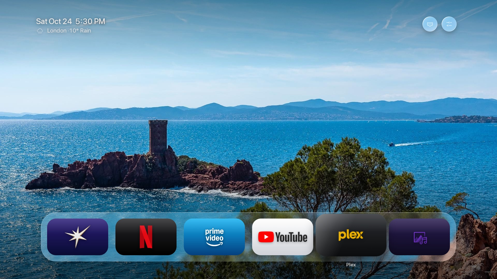
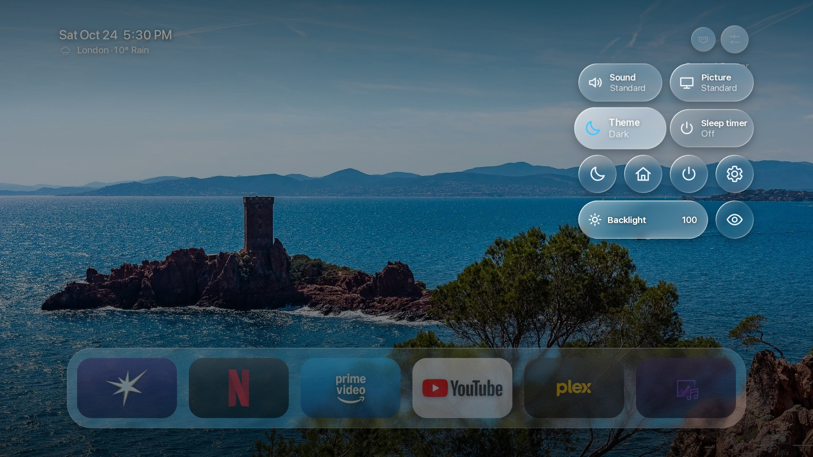
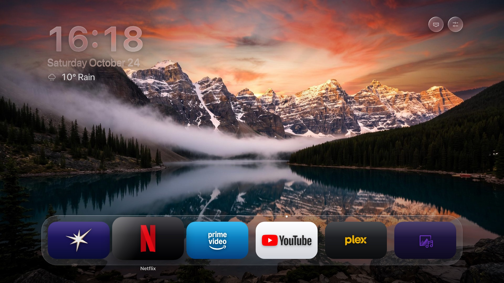
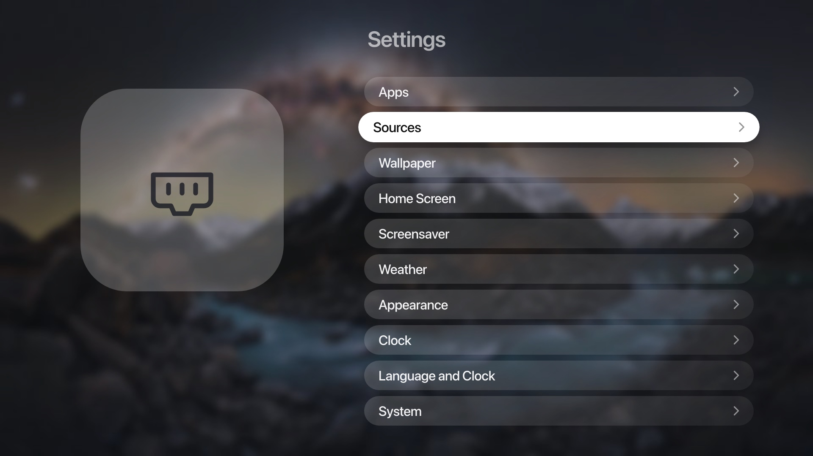
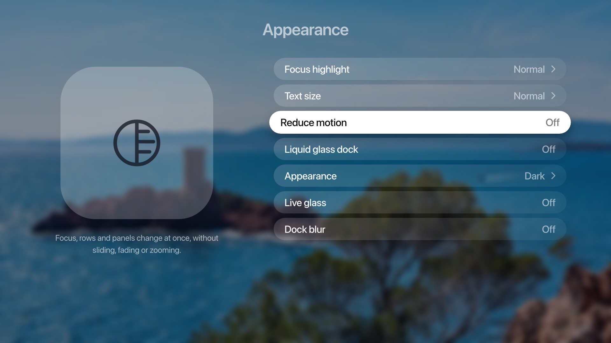
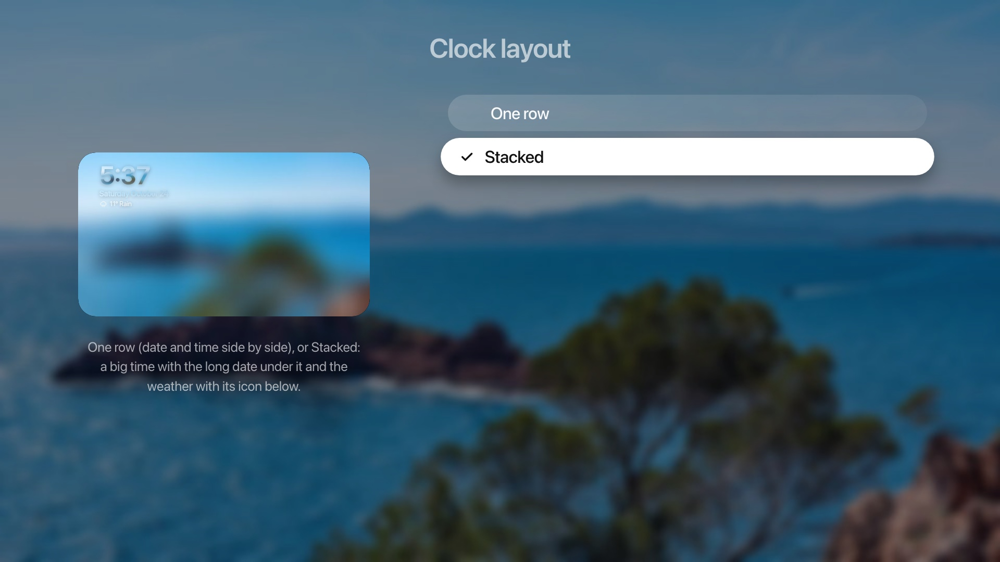

# Lumen

A tvOS-style home screen for rooted LG webOS TVs, tuned for a weak TV graphics chip. Lumen is a set of patches on top of
[partridgeworks/webos-launcher](https://github.com/partridgeworks/webos-launcher) (MIT), plus a few small scripts that run on the TV.
Its companion is [Lumen Gallery](https://github.com/ammar027/lumen-gallery-webos), an art-mode screensaver.

Tested on an LG 65UQ8040PSB (webOS 22, Chromium 87, 1.5 GB RAM). It needs a rooted TV with the
[Homebrew Channel](https://www.webosbrew.org/); a few features (screen off, restart, picture mode, the Home-button takeover) use its root service.

## Screenshots

The home screen and Control Center are screenshots of the real app on an LG 65UQ8040PSB (webOS 22). The Settings pages and the stacked clock come from the dev preview at 1920 x 1080.








## Supported TVs

Lumen is tested on webOS 22 (Chromium 87) and webOS 25. It is built for Chromium 79 and newer (webOS 6 and later). Older TVs (webOS 4.x, Chromium 53) cannot run it: Lumen
then shows a short "too old" message instead of a blank screen. Rooted TVs only for the live app list, Home button and screensaver features (see below).

## What it adds

- **tvOS navigation and look:** a glass dock row of apps, a second row of more apps and a Recent row that appear as you move down, focus lift with a name
  under the tile, a wallpaper library (cloud and bundled, shuffle per category, favourites, auto-change, night dimming), folders, hold-OK menu
  (move, remove, add to folder), and a Settings app in the same style.
- **Control Center:** a tvOS 26-style grid: sound, picture mode, theme, sleep timer, LG Home, screensaver, screen off, Settings and backlight.
- **Edit apps on the home screen:** hold OK on an app for Move, Uninstall App (a second OK confirms; never for Lumen, LG's own apps or the Homebrew Channel), Remove and Add to a folder. A lifted app moves along its row with Left and Right and a whole row with Up and Down. The remote's 1 to 6 open the first six apps on the glass bar. LG's App Store can be added to the home screen. (Ideas from Sam Renfrew's fork.)
- **Dimming:** Settings > Wallpaper > Dim the wallpaper (off, at night, always) and Settings > Home Screen > Dim when the dock is hidden.
- **Recent Apps:** a card for each open app (time-pill menu, or hold OK on an app). Up closes an app, Close all closes the lot.
- **Appearance:** Light, Dark or Auto (dark from 7 pm to 6 am), in Settings and in the Control Center; the dock can slide away with Down or after a few idle seconds.
- **Video wallpaper:** Settings > Wallpaper > Video. Pick one or several places (Switzerland, Norway, Iceland, Italy, Greece, Germany, Czechia, Spain, the Netherlands,
  Portugal and more, plus Apple's aerial videos); it streams from the internet and pauses LG's screensaver while it plays.
- **StandBy:** a full-screen face to leave on, after Apple's StandBy: Digital, Analog, Calendar, Solar, Photos, Weather, Fade and Flow, in seven colours, with a red Night Mode. Pick it as the screensaver (Settings > Screensaver).
- **Clock:** Settings > Clock has the style (digital, date, seconds, analog), colour, size, weight, position, a Stacked layout with a weather icon, and a Frosted look; every choice shows a live preview. The photo screensaver has its own clock position, size and blur.
- **Photo screensaver:** a slideshow from the wallpaper library (or your own Immich server), with the clock, date and weather. Optional [Immich](docs/immich.md) wallpaper and screensaver source.
- **First-run setup and Apple TV defaults:** a short setup on a fresh install, and one button (Settings > System) that sets everything to how tvOS starts.
- **Language and clock format:** nine languages for the menus, dates and weather, and a 12 / 24-hour option. **Weather:** pick a country and a city (about 180 cities).
- **Top left:** date, time and weather (Open-Meteo, optional city); top right: Inputs and Control Center.
- **Cheap on purpose:** no live blur or SVG filters. The "glass" is a pre-blurred copy of the wallpaper seen through the glass shapes, with static rim lights;
  only `transform` and `opacity` animate. See [RESEARCH.md](RESEARCH.md).
- **TV side** ([tools/tv/](tools/tv/)): a small watcher that turns the remote's Home button into "open Lumen" and starts Lumen Gallery when the TV's screensaver
  starts, plus an update-notification blocker.

## Easy install: download the .ipk

Don't want to build anything? Download `com.ammar027.lumen_1.1.4_all.ipk` from the [latest release](https://github.com/ammar027/lumen-webos/releases/latest) and install it on your TV:

- **With a mouse and no command line:** open [Dev Manager Desktop](https://github.com/webosbrew/dev-manager-desktop/releases), add your TV, go to *Apps* and drop the `.ipk` onto the window.
- **Or** with the webOS CLI: `npx -p @webos-tools/cli ares-install --device lgtv com.ammar027.lumen_1.1.4_all.ipk`.

The release build leaves out third-party app logos and the default wallpapers are public-domain paintings; apps without an icon get a plain tile.
Optional: see [Native Home selection](docs/native-home.md) for supported firmware, required metadata, and restoration steps.
The v1.0.9 package does not contain the required Home category. The existing redirect scripts are under [tools/tv/](tools/tv/).

## Install and update from the TV (Homebrew Channel)

In the Homebrew Channel, open its settings and add this repository URL, then install Lumen from the Channel's app list:

`https://raw.githubusercontent.com/ammar027/lumen-webos/hbc-repo/stable/apps.json`

Each tagged release (`v1.x.y`) is added to it by the GitHub workflow ([.github/workflows/release.yml](.github/workflows/release.yml)), which rebuilds the app from the upstream launcher with every layer in [REBUILD.md](REBUILD.md) (`tools/rebuild.py`). A push to `main` builds a test package and keeps it as a workflow artifact; nothing is published. Idea and repository generator from Sam Renfrew's fork.

## How to build it

`app/` is a clone of the upstream launcher and is not part of this repository. Everything changed is re-applied by the scripts in `tools/`.
See [REBUILD.md](REBUILD.md) for the exact order.

```sh
git clone https://github.com/partridgeworks/webos-launcher app
cd app && npm install
# then the steps in REBUILD.md
```

Brand icons and logos of third-party apps, and the bundled default wallpapers, are **not** included here (trademarks and other people's photographs).
`tools/gen_iconpack.py` and `tools/build_iconpack.py` build the icon tiles from logos you put in `tools/logos/` and from your own TV's app icons.

## Install on the TV

```sh
ares-setup-device           # add your TV as "lgtv" (developer mode on, or rooted)
npx -p @webos-tools/cli ares-install --device lgtv build/*.ipk
```

For native Home selection, follow [this procedure](docs/native-home.md). Installation alone does not change the default Home app.

For the existing redirect method, copy `tools/tv/watch.sh` to `/var/lib/homehook/` and `tools/tv/60-homehook` to `/var/lib/webosbrew/init.d/` on the TV.
To undo it, delete the hook file and stop `watch.sh`.

## Credits

Built on partridgeworks/webos-launcher (MIT). Ideas and pieces from two forks, both credited with thanks: [xcv58's](https://github.com/xcv58) work on a webOS 5 launcher (PR #8) and [Sam Renfrew's fork](https://github.com/samrenfrew/lumen-webos) (MIT): the Settings page stack, the tvOS 26 Control Center, the canvas backdrops, the live-glass option, the photo screensaver and Immich. See [THIRD_PARTY_NOTICES.md](THIRD_PARTY_NOTICES.md). Not affiliated with LG, Apple or any app vendor.
Licence: [MIT](LICENSE).

## TV experience fixes

See [Home behavior, black startup, faster glass rows, personal TV icons and Gallery screensaver](docs/tv-experience.md) for the final build layer and optional TV setup. Home takeover preserves previous-input startup; native Home bindings require an already-installed compatible input hook.
