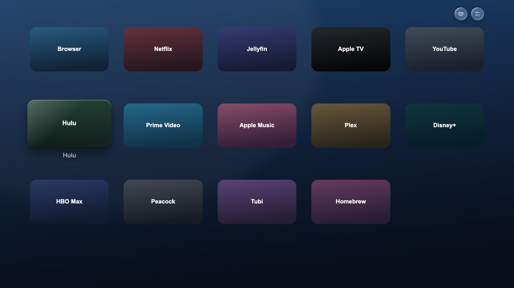
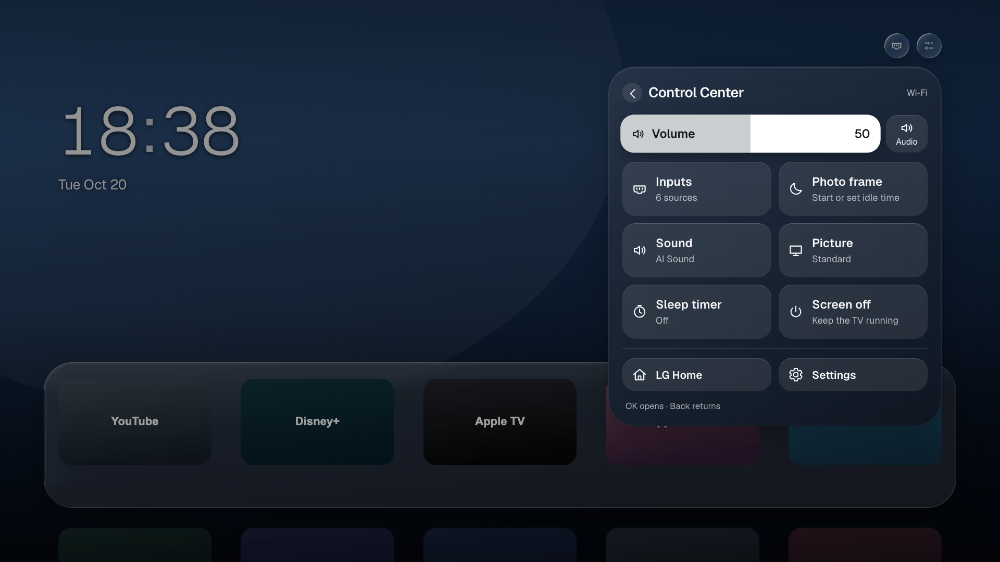
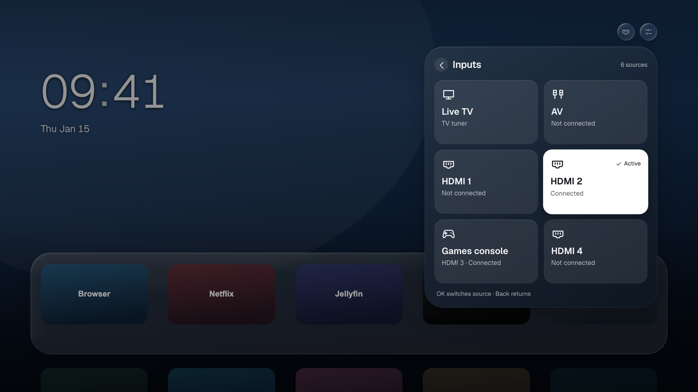

# Optional webOS 5 trial

This trial adds a five-column expanding app grid, more reliable native icon loading,
an in-app photo frame, and shared Inputs / Control Center panels. It is based on
Lumen `497e9182fd9d0d12d7ed9bfbafc0ee15d7139a79` and installs separately as
`local.lumen.trial` (version 0.3.6), preserving the original Lumen installation.

These browser previews use synthetic preferences and generated text cards, not TV data:





## Build from a fresh checkout

Requirements: Git, Python 3.9+, Node.js 22+ and npm. From the repository root:

```sh
python3 trial/prepare.py
npm --prefix app ci
npm --prefix app run build
npm --prefix app run package
```

`prepare.py` clones partridgeworks/webos-launcher at
`1e2c39b9a988ceb1b258e40e3592bda84a2aa076`, copies the readable source overlay,
reuses Lumen's own icons and Geist font, and generates text-only cards and abstract
gradient backgrounds. It refuses to overwrite an existing `app/` directory.
Use `--app-dir /path/to/a/new/directory` if the original patch pipeline already
uses `app/`; run subsequent npm commands against that new path.

The existing Lumen patch pipeline remains available as described in
[REBUILD.md](../REBUILD.md). The trial overlay is a separate, pinned source snapshot
so its current behavior can be reviewed and reproduced without replaying historical
string-replacement patches or extracting files from an installed TV.

Third-party app logos, extracted TV icons, photographic wallpapers, personal app
order, recent history, weather location, credentials and device connection helpers
are not bundled. Public builds use generic defaults. Optional local artwork can
replace files in the generated `app/public/iconpack/` and `app/public/wallpapers/`;
catalogue overrides can go in the generated app's ignored `src/config/catalog.local.ts`.
`trialSeed.json` is empty in this overlay, so fresh installs discover and seed their
own installed apps. Existing trial preferences continue to load from localStorage.

## Features

- Five apps on the first row; Down expands a five-column grid and Back collapses it.
  Hold OK retains app moving, folders and context menus. Recent apps are optional:
  Off, Not on Home, or All recent, without deleting the history.
- Optional Navigation sounds (Off / Soft) add an original, quiet 45 ms tick only
  when the remote moves between app tiles on Home. New installs and existing
  preferences default to Off. Pointer hover, blocked movement and focus restoration
  stay silent. Repeats are rate limited, playback never overlaps, and leaving Home
  cancels pending audio. One cached Web Audio buffer avoids media-element conflicts
  with video wallpapers. The engine warms silently before accepting a tick, and
  suspends after playback ends and a short inactivity period. No system volume
  or mute setting is changed.
- Native icons are read in bounded chunks, with independent failure handling and
  cache invalidation by path, file size and modification time. A failed large icon
  no longer discards every other app's icon.
- Bing scenic photos and an optional SFW Wallhaven collection share a bounded disk
  cache (48 MiB, at most 40 images per source). Failed downloads retain the last good
  collection. The photo frame adds crossfades, gentle pan/zoom, captions and a clock;
  a wake key is consumed before normal launcher navigation resumes.
- Inputs use AV/HDMI port names, preserve custom names, distinguish confirmed active
  input from last-used input, and leave missing connection status unknown. Back
  restores the panel and control that opened Inputs.
- Control Center offers explicit sound, picture, sleep, audio and photo-frame choices.
  TV settings remain unknown until read, update only after confirmation, and refresh
  while the panel is visible. Older reads cannot overwrite a newer setting change.
  Picture/sound choices are restricted to values reported as available by the TV.
  Restart lives in Settings behind a confirmation with Cancel selected.
- Cached glass, restrained focus scaling, reserved text space and a shared rounded
  surface work within Chromium 68. The tint covers the border box while the cached
  wallpaper keeps its original alignment, avoiding brighter straight borders than
  corners. One soft upper-edge highlight is shared across the quick panels.

## Install and recovery

Install the package from `app/build/` with Dev Manager Desktop or a configured
`ares-install --device DEVICE app/build/local.lumen.trial_0.3.6_all.ipk`.
Rooted-TV features use the existing Homebrew Channel service; the trial does not
install a new system service or change the Home button, startup app, LG screensaver
timer, clock or hosts file. LG Home remains available from Control Center and the
physical Home key.

The optional idle helper runs from the app package, writes only under
`/tmp/lumen-trial/`, and exits when the package disappears. It acts only while the
trial is foreground. Create `/tmp/lumen-trial/disabled` to stop its idle actions;
remove that marker to resume them. Uninstalling only Lumen Trial preserves the
separate original Lumen app. Photo downloads and idle handling run on the TV;
no build computer is needed at runtime.

## Verification

From the repository root, after preparing the default `app/` directory:

```sh
npm --prefix trial ci
npm --prefix trial run install:browser
npm --prefix trial test
```

The runner starts and stops its own local preview on port 5187. It uses synthetic
app preferences, mocked photo responses and sanitized webOS 5 control fixtures.
It checks icon chunking/cache behavior, grid editing and folders, photo-frame wake
handling, text geometry, settings errors, stale reads, outside setting changes,
active versus last-used inputs and light appearance. Artifacts go to the ignored
`.trial-evidence/` directory. Set `CHROMIUM_PATH` to use an existing Chromium binary
instead of Playwright's downloaded browser.

The navigation-sound checks separately cover migration/default Off, Soft persistence,
actual focus changes, silent pointer/boundary behavior, rate limiting, no overlap,
Settings cancellation, delayed audio unlock, a stalled startup audio clock and
unavailable audio. They instrument an audio fixture; perceived loudness and physical
output require a TV listening check.

The 0.3.5 UI implementation was installed on an LG 86UN8570AUD, webOS 5.6.2-21,
firmware 04.64.00, Chromium 68. Native package checksums, text geometry and navigation
were verified. The owner tested the physical remote, Inputs, Control Center and
photo frame, and accepted the final edge treatment. Earlier native checks changed
and restored sound, verified the sleep countdown and Off state, and routed an HDMI
input. Public fixture tests are separate from that physical evidence; the public
build uses generic cards and gradients instead of the owner's local artwork.

The 0.3.6 audio update was also installed on that TV. Native Web Audio nodes started
and completed both 45 ms ticks without overlap, blocked arrows stayed silent, Off
suppressed playback, and the engine suspended after inactivity. The real Settings
control persisted Soft while other saved preferences were preserved. Physical
loudness and perceived latency are awaiting the owner's listening check.

A full ten-minute idle check was explicitly skipped. Standby/resume, a multi-hour
slideshow and other TV models/firmwares remain unverified. This is an experimental
trial for upstream review, not a replacement for the existing release pipeline.

The pinned upstream dependency lockfile is unchanged. Its build toolchain currently
reports npm audit advisories, including two high-severity transitive dependencies
under the webOS CLI even with `--omit=dev`. Updating that toolchain is separate from
this trial overlay.
